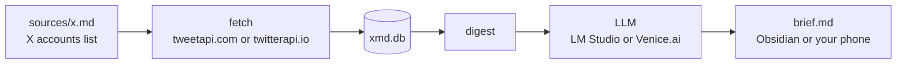

<div align="center">

# X to MD

**Stop doom scrolling on X!<br>XMD turns tweets from your favorite followings into a daily brief.**


</div>

No X account needed and no scraping of your own.
Tweets come from a paid API, are sorted by rules you write, summarized by a model on your own GPU or through an anonymized model on Venice, and saved as .md.

Run it on your laptop, or set up a small VPS once and get the brief on your phone every day, hands-off.



## What a brief looks like

```markdown
# X brief — 2026-10-15
**~900 lines · 231 pictures**

## ★ Priority
#### Frank Wire · 07:12 UTC
ACME confirms the Globex deal will close in Q1.

## Trending
- ×4 @alice · @dave · @erin · @gina — ACME and Globex agree to merge

## X / business
> In short: the ACME–Globex merger, posted about by 4 accounts, led the day.
### 🖼 Images — 9
### Summary — 18 items
- 🔥 ACME and Globex agree to merge — All-stock deal, closing in Q1. (@alice · @dave +2)
### 🔁 Retweets — 3 themes
```

- **Your rules, no algorithm.** No likes, no ranking. Accounts you mark `priority:high` are shown in full, each group gets a level, and a chatty group becomes a handful of themes.
- **Every bullet links its sources.** A summary cites the tweets it was written from. A citation the model invented is dropped.
- **Repetition is the signal.** A story several of your accounts post goes to Trending, and names far louder than usual are flagged.
- **Pictures are never summarized.** The model can't see an image, so you get the tweet itself.
- **As short as you want.** `--keep 30` keeps 30% of the day: pictures go first, summaries last.
- **Local by default.** On the laptop, summaries come from your own GPU and only the X backend you pay sees your follow list. The VPS and phone use Venice instead.

## On autopilot: VPS to phone

Set it up once and the brief comes to you, laptop off:

1. **A small VPS** (1 vCPU, 1 GB, Debian or Ubuntu) makes the brief every day on a timer, summarized by Qwen 3.5 on Venice.
2. **ntfy** notifies your phone: brief ready, or the run failed.
3. **Buttons on your Android phone** (Termux) download it, or ask for a fresh one, into `Documents/xmd-briefs` or straight into your Obsidian vault.

The phone's SSH key can only ask for a brief or download one, nothing else. No VPS? The phone can make the brief on its own.

About an hour to set up: [docs/remote-setup.md](docs/remote-setup.md). How it works: [docs/remote.md](docs/remote.md).

## Setup on the laptop

You need Python 3.10+, [LM Studio](https://lmstudio.ai), and an API key from [tweetapi.com](https://tweetapi.com) or [twitterapi.io](https://twitterapi.io).

```powershell
python -m venv .venv
. .\.venv\Scripts\Activate.ps1
pip install -e .
cp sources.example.yaml sources.yaml    # your X backend and its key
cp -r sources.example sources           # then list your accounts in sources/x.md
```

### LM Studio setup

Once, in the LM Studio app:

1. Download `qwen/qwen3.5-9b`(a model you can run on your GPU)
2. Make sure to untick **Thinking** in the model's settings and reload, otherwise replies come back empty.
3. Adjust the context length, we suggest 8192 or more.
4. Check it: `python scripts\run_headless.py --smoke` (synthetic posts, about a minute). It needs LM Studio's `lms` command, which is on PATH once the app has run.

## Daily use

```powershell
. .\.venv\Scripts\Activate.ps1
python scripts\run_headless.py --24h
```

It starts LM Studio's server, fetches, summarizes, writes `digests/<date>-<hour>-24h-brief.md` and stops the server. Add `--keep 30` for a brief 30% the size of the whole day, or use `--since-last-run` instead of `--24h` for only what is new since your last one.

## Who you follow

`sources/x.md` is one handle per line, with `## group` headers for sections:

```text
alice

## finance | level:high
NewsFrank | name:Frank Wire | priority:high
gina_alerts | reposts:off | only:airdrop

## chatter | recap:on
dave
```

Every option is in [docs/usage.md](docs/usage.md#config).

## Read later

Saved posts and web pages you won't get round to reading? Paste their links into `readlater\links.md` and run:

```powershell
python readlater\summarize.py
```

Each x.com link is recognised as an X Article, a thread, a long post or a post; any other link is a web page, read down to its main text with Defuddle, the extractor inside Obsidian Web Clipper. Each one is summarized on its own into one `readlater\summaries\<date>-<time>-summary.md`: a headline, a TL;DR, then key points. Before the model is called, the run says about what it will cost and what your Venice key can still spend, and waits for Enter. It uses the brief's tweetapi.com key, a hosted model (Venice) and, for web pages, Node.js. The setup is in [readlater/README.md](readlater/README.md).

## Docs

| | |
| --- | --- |
| [Usage](docs/usage.md) | Every command and flag, the settings, the brief part by part, its size and how to cut it, troubleshooting |
| [VPS to phone](docs/remote.md) | The automated daily brief: VPS timer, phone notification and buttons, vault delivery ([setup](docs/remote-setup.md)) |
| [Read later](readlater/README.md) | Saved X posts, Articles, threads and web pages summarized into one page |
| [Design and changelog](docs/digest-summary.md) | How the brief is built, and why |

## License

[MIT](LICENSE)
