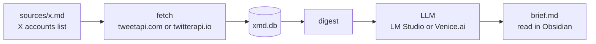

<div align="center">

# X to MD

**Stop doom scrolling on X!<br>XMD turns tweets from your favorite followings into a daily brief.**


</div>

No X account needed and no scraping of your own.
Tweets come from a paid API, are sorted by rules you write, summarized by a model on your own GPU or through an anonymized model on Venice, and saved as .md.



## What a brief looks like

```markdown
# X brief — 2026-10-15
**~25 min read**

## ★ Priority
#### Frank Wire · 07:12 UTC
ACME confirms the Globex deal will close in Q1.

## Trending
- ×4 @alice · @dave · @erin · @gina — ACME and Globex agree to merge

## X / business
> In short: the ACME–Globex merger, posted about by 4 accounts, led the day.
### 🖼 Images — 9
### Summary — 18 items
- 🔥 ACME and Globex agree to merge — All-stock deal, closing in Q1. (@alice · @dave +2)
### 🔁 Retweets — 3 themes
```

- **Your rules, no algorithm.** No likes, no ranking. Accounts you mark `priority:high` are shown in full, each group gets a level, and a chatty group becomes a handful of themes.
- **Every bullet links its sources.** A summary cites the tweets it was written from. A citation the model invented is dropped.
- **Repetition is the signal.** A story several of your accounts post goes to Trending, and names far louder than usual are flagged.
- **Pictures are never summarized.** The model can't see an image, so you get the tweet itself.
- **Fits the time you have.** `--time 10` fits the brief to ten minutes.
- **Local by default.** The summaries come from your own GPU. Only the X backend you pay sees your follow list.

## Setup

You need Python 3.10+, [LM Studio](https://lmstudio.ai), and an API key from [tweetapi.com](https://tweetapi.com) or [twitterapi.io](https://twitterapi.io).

```powershell
python -m venv .venv
. .\.venv\Scripts\Activate.ps1
pip install -e .
cp sources.example.yaml sources.yaml    # your X backend and its key
cp -r sources.example sources           # then list your accounts in sources/x.md
```

### LM Studio setup

Once, in the LM Studio app:

1. Download `qwen/qwen3.5-9b`(a model you can run on your GPU)
2. Make sure to untick **Thinking** in the model's settings and reload, otherwise replies come back empty.
3. Adjust the context length, we suggest 8192 or more.
4. Check it: `python scripts\run_headless.py --smoke` (synthetic posts, about a minute). It needs LM Studio's `lms` command, which is on PATH once the app has run.

## Daily use

```powershell
. .\.venv\Scripts\Activate.ps1
python scripts\run_headless.py --24h
```

It starts LM Studio's server, fetches, summarizes, writes `digests/<date>-<hour>-24h-brief.md` and stops the server. Add `--time 10` for a ten-minute brief, or use `--since-last-run` instead of `--24h` for only what is new since your last one.

## Who you follow

`sources/x.md` is one handle per line, with `## group` headers for sections:

```text
alice

## finance | level:high
NewsFrank | name:Frank Wire | priority:high
gina_alerts | reposts:off | only:airdrop

## chatter | recap:on
dave
```

Every option is in [docs/usage.md](docs/usage.md#config).

## Docs

| | |
| --- | --- |
| [Usage](docs/usage.md) | Every command and flag, the settings, the brief part by part, reading time, troubleshooting |
| [Without the laptop](docs/remote.md) | A daily brief from a small VPS, asked for from the phone ([setup](docs/remote-setup.md)) |
| [Design and changelog](docs/digest-summary.md) | How the brief is built, and why |

## License

[MIT](LICENSE)
